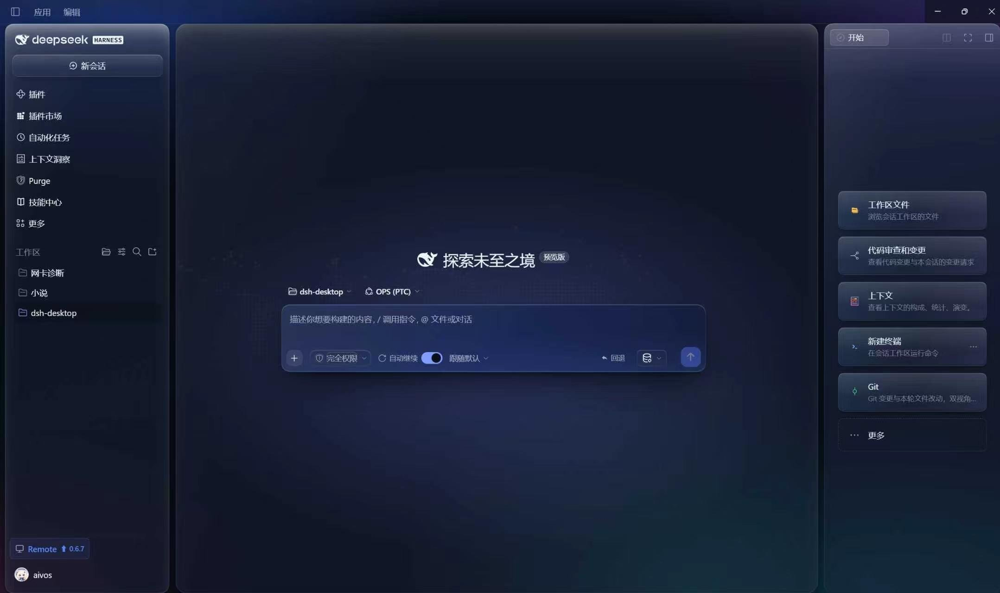
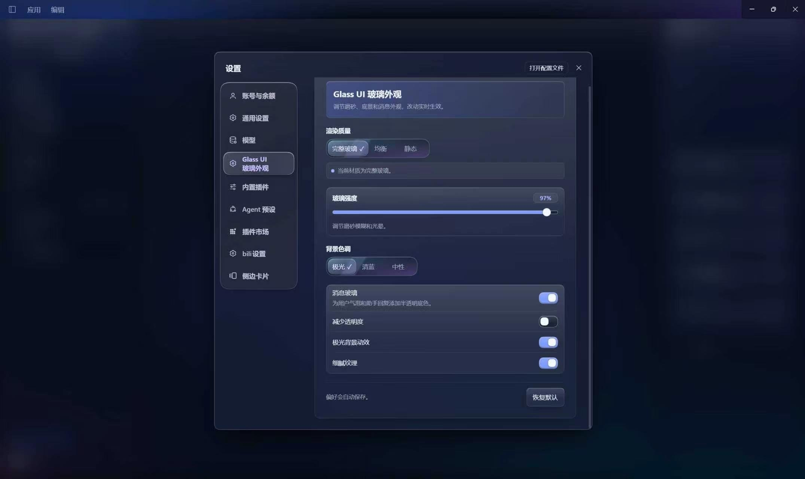

# Glass UI · DSH plugin

[简体中文](README.md) | [English](README.en.md)

**[Demo page (screenshots) →](https://aivos-xie.github.io/dsh-glass-ui/)** · [Install guide](INSTALL.md) · [Latest release](https://github.com/aivos-xie/dsh-glass-ui/releases/latest)

A glassmorphism skin for DeepSeek Harness (dsh): layered frost on the conversation, sidebar, composer and overlays, following the host's light and dark themes, with live controls for intensity and background tone.



## What it is

A **client-only** dsh plugin (`@dsh-desktop/glass-ui`, one bundle plugin plus one client plugin):

- The host entry `index.js` has an empty `apply()` — it registers no tools, takes over no services, reads no workspace files.
- All styling and interaction live in the browser and are fully reverted on disable.
- No network requests, no cookie/clipboard/message-content access; it writes only 7 `dsh.glass-ui.*` preference keys to `localStorage`.

Three layers:

| Layer | What it does | Host coupling |
| --- | --- | --- |
| Semantic tokens | ~140 `--dsw-alias-*` / `--dsw-specific-*` / `--dsw-radius-*` variables with `light`/`dark` values, stacked through `theme.overrideTokens` | Token contract only — survives host upgrades |
| Structural CSS | Aurora canvas, panel-level glass, card-level film, heaviest blur on the composer | Host class names — degrades silently when the host DOM changes |
| Behaviour | Animated selection capsule (two-spring), settings section, frame watchdog, `__dshGlass` debug API | Tab / sidebar internals |

## Features

- **Three rendering tiers**: full glass, balanced, static. Static switches to opaque surfaces and drops blur and transitions.
- **Glass intensity** 0–100% (default 60%), driving blur radius and background glow together.
- **Background tone**: aurora / cool / neutral, each following the light and dark themes.
- **Glass messages**: translucent fill for user bubbles and assistant replies, on by default.
- **Reduce transparency**: opaque surfaces, blur removed.
- **Motion and texture**: 52 s aurora drift and a fine noise texture, off by default, full tier only.
- **System preferences**: `prefers-reduced-motion`, `prefers-reduced-transparency`, `prefers-contrast: more` and `forced-colors` are honoured live; clearing them restores the previous look.
- **Automatic downgrade**: average frame time above 22 ms over 2.5 s, or 4 or fewer logical cores, drops to balanced. An explicit choice wins over the watchdog.



## Install

Full steps in [INSTALL.md](INSTALL.md). Short version:

```bash
git clone https://github.com/aivos-xie/dsh-glass-ui.git /tmp/dsh-glass-ui
dsh plugin --profile web add /tmp/dsh-glass-ui
```

Reload the dsh web page, then open **Settings → Glass UI**. Nothing in dsh itself needs patching.

It is also on the plugin market: add
`https://cdn.jsdelivr.net/gh/aivos-xie/dsh-glass-ui@main/market/index.json` under **Plugin market → index source** and search for `glass` (market installs are pinned to a commit in this repository).

## Adjusting the look

Account menu (bottom left) → **Settings** → **Glass UI** (中文界面：设置 → Glass UI 玻璃外观). Changes apply instantly and save to the current browser.

Preferences live in `localStorage` and sync across same-origin windows; a different browser or cleared site data returns to defaults.

## Console API

```js
__dshGlass.info()            // version, requested, effective, system prefs, core count
__dshGlass.quality('balanced')
__dshGlass.intensity(60)
__dshGlass.tone('cool')      // aurora | cool | neutral
__dshGlass.messages(true)
__dshGlass.transparency('reduced')
__dshGlass.motion(true)
__dshGlass.texture(true)
__dshGlass.reset()
```

`info().requested` is your choice; `info().effective` is what the tier and system preferences actually render.

## Compatibility

- Target host: the dsh `web` profile (`@deepseek-ai/dsh-web-app`). The desktop build uses the `desktop` profile — swap the profile name in the install commands.
- Browser: embedded Chromium ≥ 105 (the stylesheets use `:has()`); without `backdrop-filter` the capsule and pointer-light features are skipped.
- Coexisting skins: any third-party plugin reading the same `--dsw-*` tokens will inherit the glass look. Two skins overriding the same tokens resolve by mount order, later wins.

## Development

```bash
node build.mjs          # src/*.css + src/client.tpl.js → lib/client.js
node --check index.js && node --check lib/client.js
node test-contract.mjs  # 8 vm-based contract groups, no browser needed
```

The build is reproducible: the same `src` produces a byte-identical `lib/client.js`, and the committed artifact is built from that source.

Browser regression (development only, needs `playwright-core` and a Chromium build):

```bash
node test-browser.mjs --module-dir /path/to/playwright-project --output ./test-results
```

## Layout

```
index.js             host entry (empty apply, only so the loader can mount it)
cordis.patch.yml     bundle declaration: insert id glass-ui
src/client.tpl.js    client logic (token table, controller, settings, capsule, watchdog)
src/*.css            layered styles: glass / chat / controls / rightbar / segments / components
lib/client.js        build artifact — this is what the app loads
build.mjs            src → lib
locale/*.json        plugin-list strings (zh, en)
docs/DETAIL.md       design notes and surface details
docs/assets/         screenshots
```

Editing CSS or the template requires rebuilding `lib/client.js`, otherwise the app keeps loading the previous artifact.

## Getting listed

The dsh ecosystem has several markets: the built-in page ships with no index, the curated awesome-dsh-plugin list (published as `dsh-plugin-catalog`) takes PRs, dsh.so takes site submissions with a sandbox install test, and npm-crawling registries only see published packages. Measured sizes, the submission template and CDN caveats: [docs/SUBMIT.md](docs/SUBMIT.md).

## License

MIT, see [LICENSE](LICENSE).
