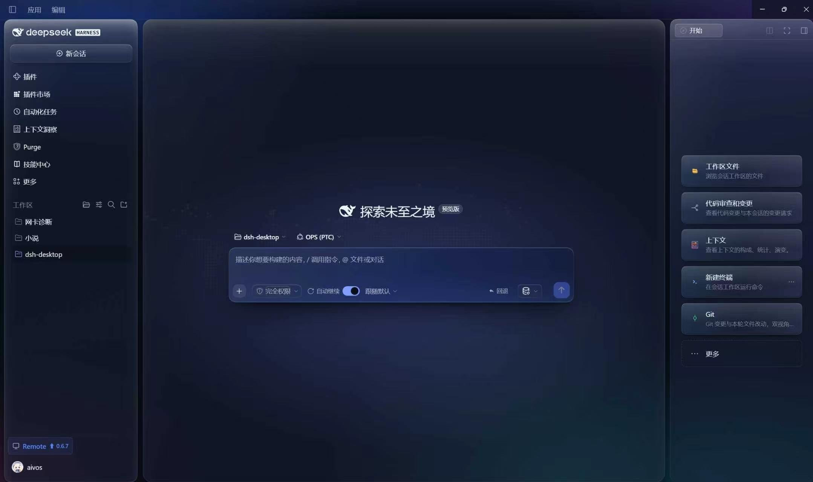
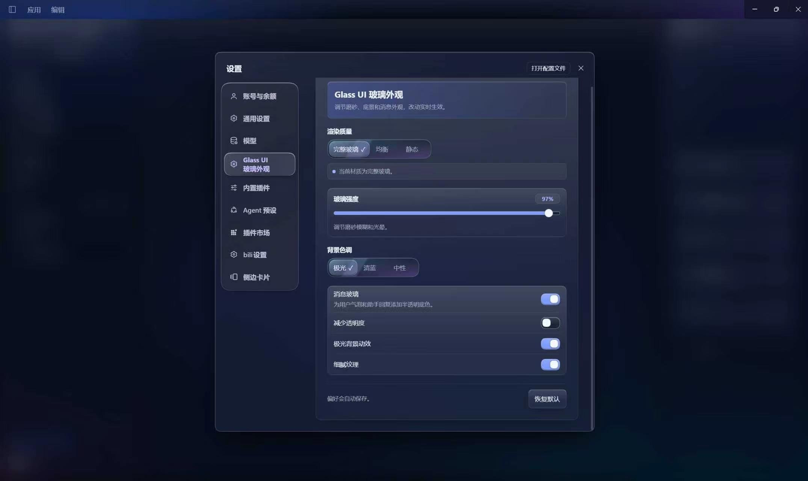

# Glass UI 玻璃外观 · DSH 插件

[简体中文](README.md) | [English](README.en.md)

**[演示页（截图） →](https://aivos-xie.github.io/dsh-glass-ui/)** · [安装教程](INSTALL.md) · [最新版本](https://github.com/aivos-xie/dsh-glass-ui/releases/latest)

给 DeepSeek Harness（dsh）用的玻璃外观插件：对话、侧栏、输入区和浮层分层磨砂，跟随宿主深浅主题，强度和背景色调都能实时调。



## 这是什么

一个**纯客户端**的 dsh 插件（`@dsh-desktop/glass-ui`，bundle plugin + client plugin）：

- 宿主侧 `index.js` 的 `apply()` 是空实现 —— 不注册工具、不接管服务、不读工作区文件；
- 全部样式与交互在浏览器里注入，卸载时完整还原；
- 不发任何网络请求，不读 cookie / 剪贴板 / 消息正文，只写 7 个 `dsh.glass-ui.*` 本地偏好键。

它做的事分三层：

| 层 | 内容 | 依赖宿主什么 |
| --- | --- | --- |
| 语义 token | 约 140 个 `--dsw-alias-*` / `--dsw-specific-*` / `--dsw-radius-*` 变量，`light` / `dark` 双值，通过 `theme.overrideTokens` 叠一层 | 只依赖宿主 token 契约，宿主升级不会崩 |
| 结构性样式 | 画布极光底景、栏级玻璃板、卡级薄玻璃、输入区最高一级模糊 | 依赖宿主 DOM 类名，宿主改版会静默降级 |
| 行为增强 | 选中态胶囊（双弹簧位移）、设置页、性能看门狗、`__dshGlass` 诊断 API | 依赖 tab / 导航的内部结构 |

## 特性

- **三档渲染质量**：完整玻璃 / 均衡 / 静态。静态档改用实色表面，并关掉模糊与过渡。
- **玻璃强度** 0–100%（默认 60%），同时控制模糊半径和底景光晕。
- **背景色调**：极光 / 清蓝 / 中性，每种都跟随深浅主题。
- **消息玻璃**：用户气泡和助手回复的半透明底色，默认开启。
- **减少透明度**：实色表面，模糊归零。
- **动效与纹理**：极光漂移（52s）与细噪点纹理，默认关闭，只在完整档可用。
- **系统偏好实时跟随**：`prefers-reduced-motion`、`prefers-reduced-transparency`、`prefers-contrast: more`、`forced-colors`，解除限制后回到上次所选外观。
- **自动降档**：2.5 秒内平均帧时间 > 22ms，或 CPU 逻辑核心 ≤ 4，自动切均衡档；手动选过质量后不再干预。



## 安装

完整步骤见 [INSTALL.md](INSTALL.md)。一行版（在 dsh 能跑的机器上）：

```bash
git clone https://github.com/aivos-xie/dsh-glass-ui.git /tmp/dsh-glass-ui
dsh plugin --profile web add /tmp/dsh-glass-ui
```

然后刷新 dsh web 页面，打开 **设置 → Glass UI 玻璃外观**。装完不用改 dsh 本身。

## 调整外观

左下角账号菜单 → **设置** → **Glass UI 玻璃外观**（英文界面：Settings → Glass UI）。改动实时生效并自动保存到当前浏览器。

偏好存在 `localStorage`，同源窗口之间同步；换浏览器或清缓存会回到默认值。

## 控制台 API

页面控制台里可以直接调，用于诊断和截图对照：

```js
__dshGlass.info()            // 版本、请求值、生效值、系统偏好、核心数
__dshGlass.quality('balanced')
__dshGlass.intensity(60)
__dshGlass.tone('cool')      // aurora | cool | neutral
__dshGlass.messages(true)
__dshGlass.transparency('reduced')
__dshGlass.motion(true)
__dshGlass.texture(true)
__dshGlass.reset()
```

`info().requested` 是你选的值，`info().effective` 是受渲染档位和系统偏好影响后实际生效的值。

## 兼容性

- 目标宿主：dsh `web` profile（`@deepseek-ai/dsh-web-app`）；桌面版 `desktop` profile 同样适用，profile 名换成 `desktop`。
- 浏览器：内嵌 Chromium ≥ 105（样式里用了 `:has()`）；`backdrop-filter` 不支持时自动跳过胶囊与追光逻辑。
- 与其它皮肤插件共存时，读同一批 `--dsw-*` token 的第三方插件会跟着玻璃化；两个皮肤覆盖同一 token 时按挂载顺序后者生效，没有仲裁。

## 开发

```bash
node build.mjs          # src/*.css + src/client.tpl.js → lib/client.js
node --check index.js && node --check lib/client.js
node test-contract.mjs  # 8 组 vm 契约回归（无需浏览器）
```

构建可复现：同一份 `src` 编出的 `lib/client.js` 逐字节一致，包里的产物就是这份源码编的。

浏览器回归（开发用，需要 `playwright-core` 与一份 Chromium）：

```bash
node test-browser.mjs --module-dir /path/to/playwright-project --output ./test-results
```

## 目录

```
index.js             宿主入口（空实现，只为被 loader 正常加载）
cordis.patch.yml     bundle 声明：insert id glass-ui
src/client.tpl.js    客户端逻辑（token 表、控制器、设置页、胶囊、看门狗）
src/*.css            分层样式：glass / chat / controls / rightbar / segments / components
lib/client.js        构建产物，应用实际加载这个文件
build.mjs            src → lib 的构建脚本
locale/*.json        插件列表用的中英文案
docs/DETAIL.md       设计说明与外观细节
docs/assets/         预览图
```

CSS 与模板改成什么样，`lib/client.js` 就得重新构建一次，否则应用加载的还是旧产物。

## License

MIT，见 [LICENSE](LICENSE)。
